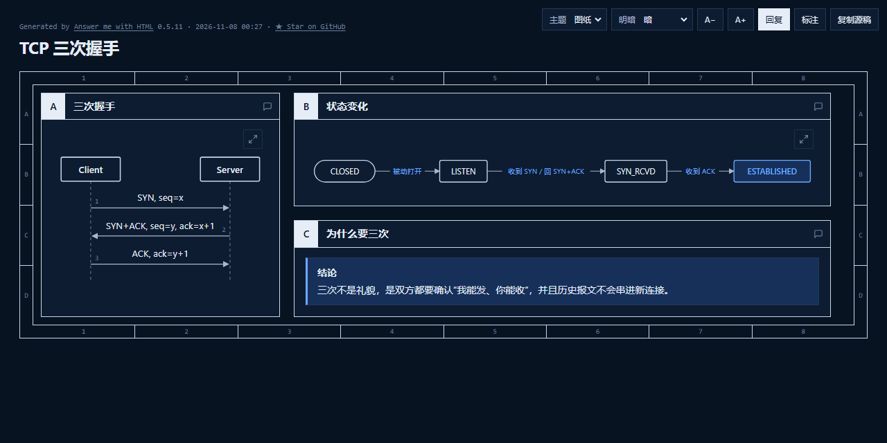

# dsh-answer-me-with-html

[](https://github.com/ShanHaiFish/dsh-answer-me-with-html/actions/workflows/test.yml)
[](https://github.com/ShanHaiFish/dsh-answer-me-with-html/releases)
[](LICENSE)

把 [Answer me with HTML](https://github.com/QingYunA/answer-me-with-html) 的原生体验带进 DeepSeek Harness（DSH）：模型只写 Markdown 草稿，插件在本地渲染成一页离线 HTML，并把页面放到右侧 Document Preview 里打开。Web 端和桌面端使用同一份插件。

> 本项目与上游 Answer me with HTML 无隶属关系，只是按 MIT 许可内置其渲染器（`skill/`）。上游版本固定为 **v0.5.11**。



<sub>示例：模型只写 Markdown 草稿，插件渲染出的单页 HTML（深色模式、自动布局的顺序图与流程图）。</sub>

## 特性

- **原生工具**：`answer_me_with_html`，不再依赖 bash/pwsh 和 heredoc，Windows 端也不会被 PowerShell 语法卡住。
- **不依赖用户安装 Node**：桌面端走 Electron 自带的 Node（`ELECTRON_RUN_AS_NODE`），Web 端走宿主 Node，最后回退 PATH 上的 `node`。
- **页面落在工作区**：默认写入 `<会话工作区>/.dsh/answer-pages/`，右侧 Document Preview 可以直接读取；不会写到 `~/.answer-me-with-html`。
- **不弹系统浏览器**：工具固定 `--no-open`，页面只在应用内打开。
- **工具卡**：显示页面标题、状态、STE/代码警告与错误；“打开页面”按钮直接打开右侧预览。
- **可离线安装**：本地目录安装，不需要联网、不需要 pnpm 构建步骤。
- **可选 always-on**：配置 `alwaysOn: true` 后，通过系统提示要求每个结论都附带一页小页面。

## 安装

要求：DSH `0.2.1-rc.2` 或 `0.2.2-rc.1`（`>0.3.0` 之前），桌面端与 Web 端各装一次。

从 GitHub 安装（推荐）：

- 在 DSH 的 **Plugins** 页 → **Add plugin**，填入：

  ```
  github:ShanHaiFish/dsh-answer-me-with-html
  ```

- 或用 CLI：

  ```powershell
  dsh plugin --profile desktop add github:ShanHaiFish/dsh-answer-me-with-html
  dsh plugin --profile web add github:ShanHaiFish/dsh-answer-me-with-html
  ```

本地开发安装（无需联网，适合调试本仓库）：

- Plugins 页 → Add plugin，填入本目录的绝对路径，例如 `F:\path\to\dsh-answer-me-with-html`；
- 或 CLI：`dsh plugin --profile desktop add "F:\path\to\dsh-answer-me-with-html"`。

安装后新开一个会话，问一个适合画图解释的问题（例如“解释 TCP 三次握手”），模型会调用 `answer_me_with_html`，会话中出现页面卡片。发布页见 [Releases](https://github.com/ShanHaiFish/dsh-answer-me-with-html/releases)。

> 不要同时安装上游 `answer-me-with-html` 和我们这个插件，否则会出现两份同名 skill。二选一。

## 使用

正常提问即可；模型根据 `answer-me-with-html` skill 判断是否值得出页面。也可以直接说“用 HTML 解释 TCP 三次握手”。

生成的页面路径会作为工具卡和回复末尾的链接出现，点击后在右侧 Document Preview 打开。页面自带的主题切换、面板评论、`ask` 决策和 Reply 按钮保留了上游的行为；能否运行页面内脚本取决于 DSH 的 Coding Tools 设置，静态阅读不受影响。

## 配置

当前通过 profile 的 `cordis.patch.yml` 覆盖 `answer-me-with-html` 行的 `config`：

```yaml
- id: answer-me-with-html
  name: dsh-answer-me-with-html
  config:
    outputDir: ''          # 空 = <workspace>/.dsh/answer-pages；也可填绝对路径
    theme: auto            # auto | blueprint | shadcn | paper | 已安装主题
    mode: auto             # auto | light | dark
    style: '80'            # off | 80 | strict
    alwaysOn: false        # true = 每个结论都附带页面
    nodePath: ''           # 手动指定 node；空 = 自动探测
    maxDraftBytes: 200000
```

修改配置后重启对应 profile（或等待 HMR 重新加载）。

## 工作方式

```
提问
 └─ 模型读 skill：草稿格式 / 选组件 / 写作规则
      └─ 调用 answer_me_with_html(draft, file_name, theme, mode, style)
           ├─ Host 解析运行时：Electron-as-node → 宿主 Node → PATH node
           ├─ spawn skill/scripts/am.mjs render - --no-open -o <workspace>/.dsh/answer-pages/x.html
           ├─ 解析 ✓ / ✗ Lxx / STE 警告
           └─ 返回 { ok, path, title, warnings, errors }
                ├─ 客户端工具卡：标题 / 状态 / 警告 / 打开按钮
                └─ 打开按钮 → Document Preview
```

## 开发

```powershell
node --check lib/host.js
node --check lib/renderer.js
node --check lib/client.js
node --test test/
```

同步上游渲染器：

```powershell
node scripts/sync-upstream.mjs v0.5.11
```

## 已知限制

- 只支持 HTML 页面；`am video` / `am serve` / `am export` 不在本插件范围内。
- 页面内脚本（主题、Reply 等）是否运行取决于 DSH 的 Coding Tools 设置；关闭时页面仍可静态阅读。
- 尚未提供设置页；配置写在 profile patch 中（`settings` 页在后续版本加入）。
- 上游 skill/渲染器更新需要手动执行同步脚本并回归测试。

## 验证情况

- DSH Desktop `0.2.2-rc.1`：安装、Host 工具、页面渲染、skill 目录、客户端 bundle 组装均已验证；工具卡在 UI 中的最终视觉效果需在使用时确认。
- `dsh web` `0.2.1-rc.2`：profile 安装与 Web boot graph 中的客户端 bundle 已验证。
- 单元测试：`node --test test/renderer.test.mjs test/client.test.mjs`（渲染、错误行、路径安全、卡片逻辑、注册协议）。

## 发布（可选）

当前 `package.json` 带 `"private": true`，只用于本地目录安装。要发布到 npm：

1. 去掉 `private`，把 `version` 升到新值，并把 `repository` 改成本仓库地址；
2. 确认 `files` 包含 `lib/`、`skill/`、`locale/`、`icon.svg`、`cordis.patch.yml` 和许可文件；
3. `npm publish --access public`。

发布后即可用 `dsh plugin --profile <name> add dsh-answer-me-with-html` 安装。


## 许可

本项目代码：MIT，见 [LICENSE](LICENSE)。

内置的 Answer me with HTML skill 与渲染器：MIT，版权归上游作者，见 [LICENSE-answer-me-with-html](LICENSE-answer-me-with-html)。第三方依赖（marked、dagre、temml、Bangers 字体）声明见 [THIRD_PARTY_NOTICES.md](THIRD_PARTY_NOTICES.md)。
